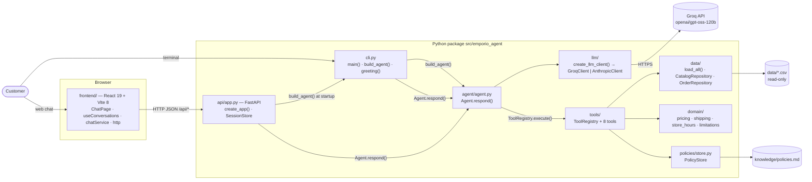
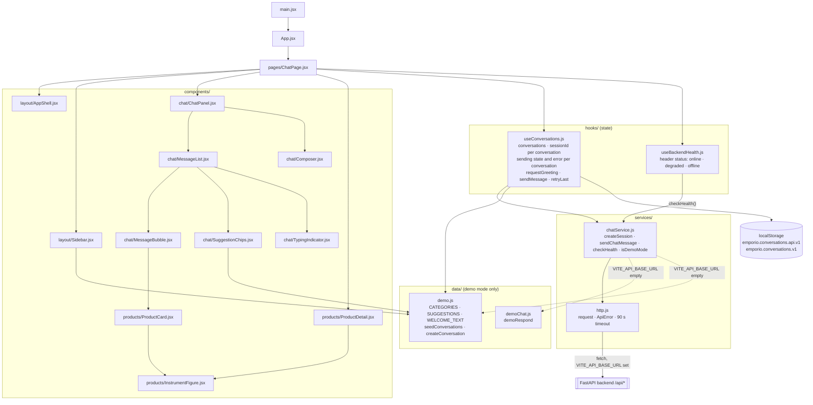
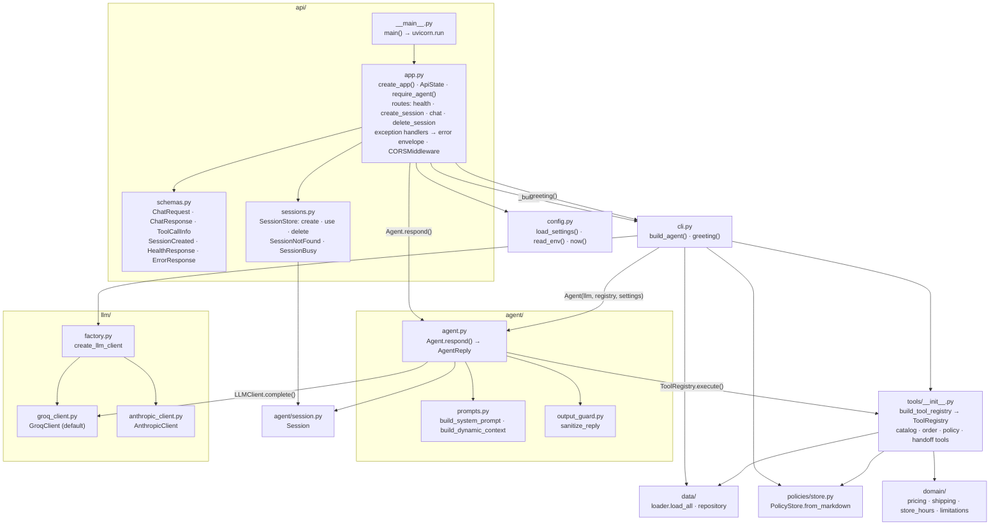
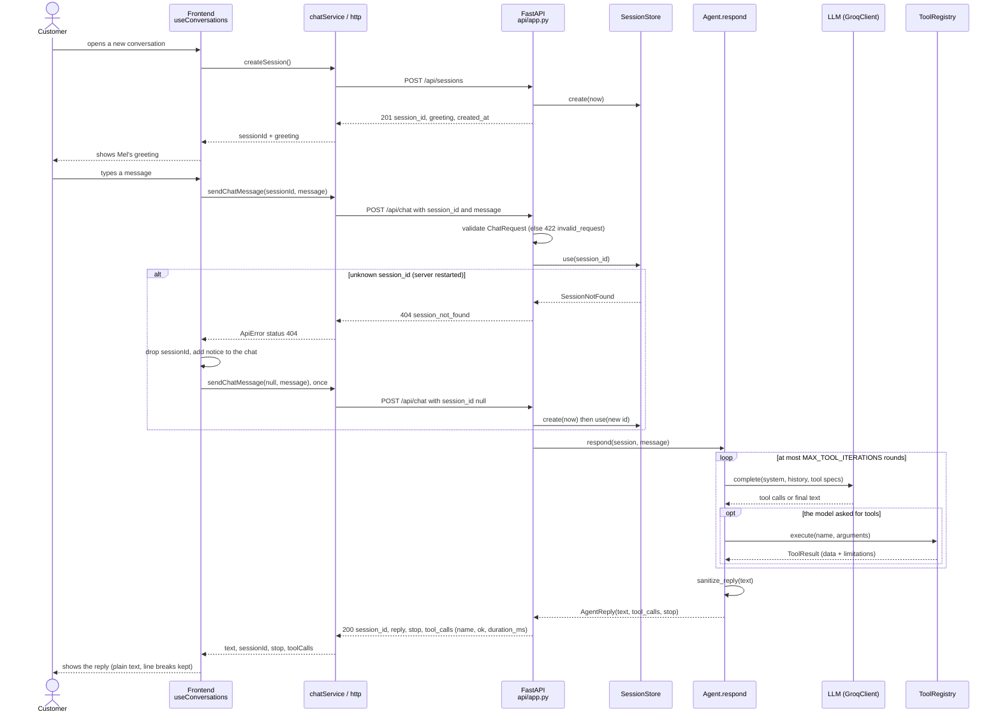

# Empório da Música — customer service agent

Text-based customer service agent for the fictional musical instrument store Empório da Música, built as a prototype for the Artefact technical challenge. The same agent is reachable from a terminal (CLI) and, through a thin HTTP API (FastAPI), from a web chat (React + Vite). This README reports real results from runs with the Groq API (the default provider) and, on 2026-11-03, one regression run and one example recording with the Anthropic API (`claude-sonnet-5-5`, the configurable alternative). Anything not yet validated with the real model is marked as pending; nothing pending is presented as passed.

## Contents

- [Overview](#overview)
- [Implemented features](#implemented-features)
- [Technologies](#technologies)
- [Installation and configuration](#installation-and-configuration)
- [Running](#running)
- [HTTP API](#http-api)
- [Tests](#tests)
- [Utilities](#utilities)
- [Architecture](#architecture)
- [Folder structure](#folder-structure)
- [Technical decisions](#technical-decisions)
- [Data handling and ambiguities](#data-handling-and-ambiguities)
- [Known limitations](#known-limitations)
- [Conversation examples](#conversation-examples)
- [End-to-end scenario results (T14)](#end-to-end-scenario-results-t14)
- [What I would do with more time](#what-i-would-do-with-more-time)
- [Use of AI tools](#use-of-ai-tools)

## Overview

The assistant, named Mel, talks to the customer in Brazilian Portuguese and answers questions about:

- the product catalog (search, details, categories, promotional price, PIX price and installments);
- orders (lookup with identity verification);
- store policies (opening hours, payment, exchanges and returns, shipping, warranty, privacy);
- general store information, complaints and handoff to a human agent.

The agent uses **function calling (tool use)**: the model decides when to call deterministic tools that query the CSV files or the policy manual. Every numeric rule (prices, installments, shipping, opening hours) is computed in Python; the model only writes the reply. When the manual or the data are contradictory or silent, the agent reports a limitation instead of inventing a rule.

How a turn works: the customer message goes to the model together with the system prompt and the tool schemas; the model may call tools (up to `MAX_TOOL_ITERATIONS` rounds); each tool returns structured data plus a list of limitations; the model writes the final reply from that data; the reply passes through an output guard before it is shown.

**Three ways in, one agent.** All entry points build the agent with the same function, `cli.build_agent`, and call the same `Agent.respond(session, text)`; no agent logic is duplicated.

| Entry point | What it is | Status |
|---|---|---|
| CLI (`python -m emporio_agent`) | Interactive terminal conversation (`rich`), `--debug`, transcripts | Original deliverable; used for every real-model run (T14, T15) |
| HTTP API (`python -m emporio_agent.api`) | FastAPI, four routes under `/api`, sessions in memory, Swagger at `/docs` | Commit `40cafe0`; covered by automated tests with a fake LLM |
| Web frontend (`frontend/`) | React 19 + Vite 8 chat that calls the API; falls back to a clearly labeled demo mode without an API URL | Commit `773ed61`; lint and build checked; not tested against the real provider |

## Implemented features

**Eight tools** (names are in Portuguese because they are part of the customer-facing domain):

| Tool | What it does |
|---|---|
| `buscar_produtos` | Searches the catalog by text, category and price range (fuzzy-normalized search; list prices, no promotion applied to the filter). |
| `detalhar_produto` | Returns one product: final price, promotion, PIX price, installments, stock, specifications and registration conflicts. Also answers direct queries about discontinued or `coming_soon` products with the explicit status. |
| `listar_categorias` | Lists the store categories with the number of available products. |
| `consultar_pedido` | Looks up an order (status, items, recorded total, tracking, estimated delivery). Requires the order number plus the email or phone of that order's customer; never returns contact details or the address. |
| `consultar_politica` | Returns the full text of a section of the policy manual, chosen from a fixed list of topics. |
| `informacoes_loja` | Address, phones/WhatsApp, emails and opening hours, and whether the store is open now with the next opening time. |
| `estimar_frete` | Shipping cost and delivery time from the city and order value, following the manual. |
| `encaminhar_atendente` | Registers a complaint or case and hands it to a human agent, returning a local protocol number. |

**Persona and scope.** Mel is polite, uses no emojis, only discusses the store's instruments and services, and politely declines unrelated topics.

**Explicit limitations.** Tools return `Limitation {code, message, source}` entries when the manual or the data are ambiguous (decision D15). The agent passes them on instead of filling the gap with assumptions. Examples: no return/exchange verdict (the purchase channel and the real delivery date are not recorded), installments in a contradictory range shown as "to be confirmed", shipping outside Campo Grande without a postal-code table.

**Output protection.** The prompt forbids emojis, but the model occasionally produced one, so `agent/output_guard.py` strips emojis (and normalizes typographic hyphens in phone numbers) from the final reply before it reaches the customer. Prompt-injection defense and customer data protection live in the tool layer (identity check on orders, no contact data returned), not only in the prompt.

**Handoff to a human agent.** Complaints, explicit requests to talk to a person and cases that the tools and the manual cannot resolve (for example a return that depends on data the system does not have) go through `encaminhar_atendente`, which returns a protocol number such as `EM-20260325-DA4D43` (see example 3). The protocol is local; there is no real ticketing system.

## Technologies

- Python 3.13
- Groq SDK (`groq`) with `openai/gpt-oss-120b` as the default model
- Anthropic SDK (`anthropic`) as a configurable alternative
- pandas (CSV data in memory), pydantic (tool argument and result models, API schemas), pypdf (offline extraction of the policy PDF), rapidfuzz (fuzzy product search), rich (CLI formatting), python-dotenv, tzdata
- FastAPI (HTTP API) served by uvicorn (ASGI server)
- pytest (tests); httpx, only because FastAPI's `TestClient` needs it in the API tests
- Frontend: React 19 and Vite 8 (`@vitejs/plugin-react`), oxlint for linting; plain CSS, no UI library, no router, no state library (state lives in one hook). Node.js 20+.

Pinned versions are in [requirements.txt](requirements.txt) and [frontend/package.json](frontend/package.json) (exact versions in `frontend/package-lock.json`).

## Installation and configuration

Requirements: Python 3.13 (`requires-python = ">=3.13"`) and a Groq API key (`GROQ_API_KEY`) to talk to the default model. Alternatively, an Anthropic key (`ANTHROPIC_API_KEY`) with `LLM_PROVIDER=anthropic`. The automated tests need no key.

```bash
python -m venv venv
# Linux/macOS/Git Bash:        source venv/bin/activate   (Git Bash on Windows: source venv/Scripts/activate)
# PowerShell:                  venv\Scripts\Activate.ps1
pip install -r requirements.txt
cp .env.example .env           # PowerShell: Copy-Item .env.example .env
```

Edit `.env` and fill in `GROQ_API_KEY`. The `.env` file is not versioned. Variables (defaults as in [.env.example](.env.example)):

| Variable | Default | Purpose |
|---|---|---|
| `LLM_PROVIDER` | `groq` | AI provider (`groq` or `anthropic`) |
| `LLM_MODEL` | `openai/gpt-oss-120b` | model |
| `LLM_MAX_TOKENS` | `4096` | response token limit |
| `LLM_EFFORT` | `medium` | reasoning depth (`low`, `medium`, `high`, `xhigh`, `max`); on Groq it maps to `reasoning_effort` for `gpt-oss` models (`xhigh` and `max` become `high`) |
| `LLM_REFUSAL_FALLBACK` | `true` | server-side refusal fallback (Anthropic provider only) |
| `GROQ_API_KEY` | empty | Groq API key (default provider) |
| `ANTHROPIC_API_KEY` | empty | Anthropic API key (only with `LLM_PROVIDER=anthropic`) |
| `REFERENCE_DATE` | empty | controlled date/time (see [Running](#running)) |
| `MAX_TOOL_ITERATIONS` | `6` | tool loop iteration limit |
| `MAX_HISTORY_TURNS` | `50` | history window |
| `CORS_ORIGINS` | `http://localhost:5173,http://127.0.0.1:5173` | HTTP API only: comma-separated origins allowed by CORS (the Vite dev server) |
| `MAX_SESSIONS` | `200` | HTTP API only: sessions kept in memory; above it, the least recently used idle session is dropped |

Note: the default of `LLM_EFFORT` is now `medium` (it was `low` earlier in the project; see [Technical decisions](#technical-decisions)). An older local `.env` that still contains `LLM_EFFORT=low` overrides the default, so update or remove that line.

To use Anthropic instead, set `LLM_PROVIDER=anthropic`, `LLM_MODEL=claude-sonnet-5-5`, `LLM_MAX_TOKENS=16000` and `ANTHROPIC_API_KEY`.

## Running

There are three ways to run the project. The CLI and the API read the same `.env` at the repository root; the frontend has its own `frontend/.env`.

### CLI (terminal)

```bash
python -m emporio_agent            # interactive conversation
python -m emporio_agent --debug    # shows the tools called in each reply
python -m emporio_agent --save     # saves the conversation on exit
python -m emporio_agent --version
```

Commands inside the conversation (in Portuguese, like the rest of the customer-facing interface):

| Command | Effect |
|---|---|
| `/salvar` | saves the conversation to `runtime/transcripts/conversa-<date>-<id>.md` |
| `/nova` | starts a new conversation |
| `/ajuda` | lists the commands |
| `/sair` | exits |

By default the agent uses the real system date and time (time zone `America/Campo_Grande`). To reproduce a situation with a fixed date (tests and examples), set `REFERENCE_DATE` in `.env` in ISO 8601, for example `2026-03-25` or `2026-03-25T10:30`. Orders in the dataset go up to 2026-03-22; with the real date, every order already looks old.

Without an API key for the selected provider (for example, no `.env`), the CLI exits with a clear message in Portuguese and exit code 2.

### Backend: HTTP API

From the repository root, with the virtual environment active and `GROQ_API_KEY` in `.env`:

```bash
python -m emporio_agent.api                                       # uvicorn on http://127.0.0.1:8000
python -m uvicorn emporio_agent.api.app:app --reload --port 8000  # same app, with auto-reload
```

Interactive documentation (Swagger) at <http://localhost:8000/docs>; OpenAPI schema at `/openapi.json`. Without a key the server still starts, in **degraded mode**: `GET /api/health` answers `"status": "degraded"` with the reason, and the conversation routes answer `503 agent_unavailable` (the CLI, in the same situation, exits with code 2).

### Frontend (web chat)

Requires Node.js 20+. In a second terminal:

```bash
cd frontend
cp .env.example .env        # PowerShell: Copy-Item .env.example .env  — sets VITE_API_BASE_URL=http://localhost:8000
npm install
npm run dev                 # http://localhost:5173
```

`VITE_API_BASE_URL` selects the mode. Filled in: **API mode**, the chat talks to the real agent through the backend above. Empty or missing: **demo mode**, with fictional answers from `frontend/src/data/` and no agent at all; the header shows "Modo demonstração" and a footer notice says the answers are fictional. The variable is read at dev/build time, so restart `npm run dev` after changing it. Other scripts: `npm run lint` (oxlint), `npm run build` (writes `frontend/dist/`), `npm run preview`. Details: [frontend/README.md](frontend/README.md).

## HTTP API

Base URL `http://localhost:8000`, prefix `/api`, JSON in UTF-8. The examples below are real responses of the app, produced in-process with FastAPI's `TestClient`, a fake LLM and reference date 2026-03-25 10:00; the chat `reply` is therefore the fake model's text, not Mel's. `<session_id>` stands for the opaque random token generated by the API with `secrets.token_urlsafe`.

| Method and path | Purpose | Success | Errors |
|---|---|---|---|
| `GET /api/health` | Service and agent status | 200 | — |
| `POST /api/sessions` | Start a conversation; returns Mel's greeting (same text as the CLI, generated locally, no LLM call) | 201 | 413, 503, 500 |
| `POST /api/chat` | Send a customer message; `session_id` null or missing creates a new session (without a greeting) | 200 | 404, 409, 413, 422, 503, 500 |
| `DELETE /api/sessions/{session_id}` | End a conversation (removes it from memory) | 204, no body | 404, 500 |

```http
GET /api/health                       → 200
{"status": "ok", "agent_ready": true, "provider": "groq", "model": "openai/gpt-oss-120b", "detail": null}

GET /api/health   (no GROQ_API_KEY)   → 200
{"status": "degraded", "agent_ready": false, "provider": "groq", "model": "openai/gpt-oss-120b",
 "detail": "Chave da API não configurada. Copie .env.example para .env e preencha GROQ_API_KEY."}

POST /api/sessions                    → 201
{"session_id": "<session_id>",
 "greeting": "Olá! Eu sou a Mel, assistente virtual da Empório da Música. Como posso ajudar?\n\nA loja está aberta agora (hoje, das 09:00 às 18:00).",
 "created_at": "2026-03-25T10:00:00-04:00"}

POST /api/chat  {"session_id": "<session_id>", "message": "Oi"}   → 200
{"session_id": "<session_id>", "reply": "(texto da FakeLLM)", "stop": "end_turn", "tool_calls": []}

DELETE /api/sessions/<session_id>         → 204
```

`message` is stripped and must have 1 to 2000 characters; `session_id`, when present, at most 64 characters; the whole body at most 16 KiB (else 413). `stop` is one of `end_turn`, `max_tokens`, `refusal`, `max_iterations`, `llm_error`. A provider failure during the conversation is **still a 200** with `stop: "llm_error"` and Mel's fallback text, exactly as in the CLI. Each item of `tool_calls` carries only `name`, `ok` and `duration_ms`; tool **arguments are never returned**, because those of `consultar_pedido` and `encaminhar_atendente` contain personal data.

**Error envelope.** Every error, including validation (422) and unexpected failures (500), has the same shape, with a message in Portuguese meant for the end user and no stack trace:

```http
POST /api/chat  {"session_id": "deadbeef", "message": "Oi"}   → 404
{"error": "session_not_found", "message": "Sessão não encontrada. Ela pode ter expirado ou o servidor foi reiniciado; inicie uma nova conversa."}

POST /api/chat  {"session_id": "<session_id>", "message": "   "}  → 422
{"error": "invalid_request", "message": "A mensagem não pode ficar vazia."}

POST /api/sessions   (no GROQ_API_KEY)                        → 503
{"error": "agent_unavailable", "message": "O atendimento está indisponível no momento. Tente novamente mais tarde."}
```

| HTTP | `error` | When |
|---|---|---|
| 422 | `invalid_request` | invalid body, empty or too long `message` |
| 404 | `session_not_found` | unknown `session_id` (for example after a server restart: sessions live only in memory) |
| 409 | `session_busy` | a message is already being processed in that session |
| 413 | `payload_too_large` | request body above 16 KiB, rejected before the JSON is read |
| 503 | `agent_unavailable` | the agent could not be built (missing key, data or policies failed to load) |
| 500 | `internal_error` | unexpected exception (logged on the server, details never sent to the client) |

## Tests

Two kinds of verification, kept apart on purpose:

**1. Automated local tests: no real model, no network.**

```bash
python -m pytest -q          # full Python suite, never calls the real model
cd frontend && npm run lint && npm run build   # frontend: static checks and production build
```

Unit and integration tests use a fake LLM (`FakeLLM` in `tests/fakes.py`). The API tests (`tests/test_api.py`) run the FastAPI app in-process with `TestClient` and the same fake LLM: routes, status codes, error envelope, degraded mode, CORS preflight, OpenAPI routes, session store (limit, eviction, busy session, concurrent requests, random session ids), body size limit (413) and the absence of tool arguments and personal data in responses. Current state: **1099 passed, 2 deselected** (the two `llm` smoke tests below); it was 1091 at commit `773ed61`, before the fixes from the final review. `npm run lint` and `npm run build` pass. The frontend has **no automated tests** (no unit or browser tests).

**2. Tests with the real provider (Groq), run by hand and limited by the free-tier quota.**

```bash
python -m pytest -q -m llm   # smoke tests against the real provider (require GROQ_API_KEY / ANTHROPIC_API_KEY)
python scripts/run_scenarios.py ...   # end-to-end scenarios (T14), see below
```

Tests marked `llm` are skipped by default (`addopts = "-m 'not llm'"`). The real-model results ([End-to-end scenario results](#end-to-end-scenario-results-t14), [docs/E2E_RESULTS.md](docs/E2E_RESULTS.md), the recorded examples) were all obtained **through the agent directly** (`scripts/run_scenarios.py`, `scripts/record_example.py`), never through the HTTP API or the web frontend. **No conversation through frontend → API → Groq has been run yet**; the API and the frontend are verified only by the automated checks above.

## Utilities

```bash
python scripts/build_policies.py          # regenerates knowledge/policies.md from the PDF
python scripts/build_policies.py --check  # checks that the versioned .md is up to date with the PDF
python scripts/run_scenarios.py           # end-to-end scenarios with the real model (T14)
python scripts/run_scenarios.py --pause 60 --report runtime/scenarios.md   # spaced out, with a Markdown report
python scripts/record_example.py --script PATH --out PATH   # records a real example conversation (T15)
```

`scripts/run_scenarios.py` requires an API key (exit code 2 without one) and accepts `--only` (scenario ids, e.g. `5,9`), `--repeat` (default 2), `--reference-date` (default `2026-03-25T10:00`), `--pause SECONDS` (pause between scenarios and repetitions, default 60) and `--report` (writes a Markdown report). The pause exists because of the Groq per-minute rate limits. Contract: [ARCHITECTURE.md](ARCHITECTURE.md), section 5.9.1.

`scripts/record_example.py` takes a script of customer messages (`--script`), an output file (`--out`), and optionally `--title`, `--reference-date`, `--pause` (default 20 s between turns) and `--force`. Contract: [ARCHITECTURE.md](ARCHITECTURE.md), section 5.9.2.

## Architecture

Diagrams are in Mermaid (rendered by GitHub and by Obsidian). Every box names a real file, class or function of the repository.

### Software architecture (whole system)



The API is a thin layer: it reuses `cli.build_agent` and `cli.greeting`, keeps `agent.session.Session` objects in memory, and translates `Agent.respond` results into JSON. The frontend never talks to the model; it only knows the four `/api` routes.

### Frontend (`frontend/src`)



Components never call `fetch` or know URL paths: `services/http.js` is the only HTTP client and `services/chatService.js` the only place that knows the `/api` routes. In API mode, replies are plain text (`products: []`), so `ProductCard` and `ProductDetail` only appear in demo mode. `utils/time.js` (time formatting) and `components/icons.jsx` (SVG icons) are omitted from the diagram.

### Backend (`src/emporio_agent`)



If `build_agent` fails at startup (missing key → `LLMError`; data or policies → `DataLoadError` / `PolicyStoreError`), `create_app` still returns an app with `agent = None`: health reports `degraded` and the other routes answer 503. Importing `emporio_agent.api.app` does not build the agent; the module-level `app` is created on first access.

### Sequence: one conversation through the web chat



Other errors on the way back: on `409 session_busy` (the server is still working on an earlier message of that session, for example after a client timeout) the frontend waits and retries automatically up to three times (after 2, 3.5 and 5 s) before showing the error. `503 agent_unavailable`, network failures and the 90-second client timeout become a clear message in that conversation's error banner; a `422` is shown without the "Tentar de novo" button, since resending would fail again. Sending state and errors are kept per conversation, so a slow reply in one conversation does not unlock, block or show its error in another. The composer limits the message to 2000 characters (the API limit), with a counter near the end. The header status comes from `GET /api/health`, queried once when the page loads (`hooks/useBackendHealth.js`: online, degraded or offline) instead of a fixed "Online". A provider error inside `Agent.respond` is not an HTTP error: the reply is Mel's fallback text with `stop: "llm_error"`.

Principles (unchanged by the API and the frontend): the original `data/` is never modified; the LLM writes and Python computes; dependencies flow one way (`cli | api → agent → tools → data | domain | policies`); everything is testable without an LLM except the loop itself (tested with a fake LLM); no agent framework, database or vector store. Contracts between modules: [ARCHITECTURE.md](ARCHITECTURE.md) (section 5; the HTTP layer is section 5.10).

## Folder structure

```
emporio-da-musica-agent/
├── data/                        # original challenge files (CSV + policy PDF), never modified
├── knowledge/policies.md        # policy manual converted from the PDF (scripts/build_policies.py)
├── src/emporio_agent/
│   ├── __main__.py              # python -m emporio_agent → cli.main()
│   ├── cli.py                   # terminal interface; build_agent() and greeting() shared with the API
│   ├── config.py                # Settings from .env (provider, model, REFERENCE_DATE, limits)
│   ├── api/                     # HTTP layer (FastAPI)
│   │   ├── __main__.py          # python -m emporio_agent.api → uvicorn on 127.0.0.1:8000
│   │   ├── app.py               # create_app(): routes, error envelope, CORS, degraded mode
│   │   ├── schemas.py           # Pydantic request/response/error models
│   │   └── sessions.py          # SessionStore: in-memory sessions, lock per session, LRU limit
│   ├── agent/                   # Agent.respond (tool-use loop), Session, prompts, output guard
│   ├── llm/                     # LLMClient interface, Groq (default) and Anthropic adapters
│   ├── tools/                   # 8 tools + ToolRegistry
│   ├── data/                    # CSV loader, models, quality checks, repositories
│   ├── domain/                  # pure rules: pricing, shipping, store hours, limitations
│   └── policies/store.py        # PolicyStore: sections of knowledge/policies.md
├── frontend/                    # web chat (React 19 + Vite 8)
│   ├── .env.example             # VITE_API_BASE_URL
│   ├── public/                  # favicon and demo images
│   └── src/
│       ├── main.jsx, App.jsx
│       ├── pages/ChatPage.jsx
│       ├── components/          # chat/, layout/, products/, icons.jsx
│       ├── hooks/useConversations.js
│       ├── services/            # http.js (only HTTP client), chatService.js (only place with /api paths)
│       ├── data/                # demo mode only: demo.js, demoChat.js
│       ├── styles/, utils/
├── scripts/                     # build_policies.py, run_scenarios.py (T14), record_example.py (T15)
├── tests/                       # pytest suite (FakeLLM); tests/test_api.py covers the HTTP API
├── examples/conversations/      # real example conversations (T15)
├── docs/                        # PROGRESS.md, AGENT_GUIDE.md, E2E_RESULTS.md, e2e/ (real transcripts)
├── .env.example                 # backend configuration (copy to .env)
├── requirements.txt, pyproject.toml
└── README.md, ARCHITECTURE.md, TECHNICAL_DECISIONS.md, TASKS.md, DATA_ANALYSIS.md
```

## Technical decisions

Full rationale in [TECHNICAL_DECISIONS.md](TECHNICAL_DECISIONS.md).

- **Agent approach (D1).** Function calling with a custom loop of about 100 lines and an iteration limit. Rejected: SQL agent (room for wrong queries and it exposes the customer table), pure RAG (price and stock need exactness and numeric filters) and LangChain/LangGraph/LlamaIndex (abstraction with no gain at this size). Every query decision is observable in the tool log (`--debug`).
- **Calculations in Python (D4).** Promotional price, PIX, installments, shipping and "open now?" come out of the tools ready to use, with `Decimal` and `ROUND_HALF_UP` rounding. The manual treats incorrect information as false advertising, and models make arithmetic and date mistakes.
- **Default provider: Groq (D5, D17).** The decision to use Groq came from the user. `LLM_PROVIDER=groq` selects the adapter in `llm/groq_client.py` (official `groq` SDK) behind a thin `LLMClient` interface; provider and model are switchable by configuration.
  - Model `openai/gpt-oss-120b`: a Groq production model (not preview) with tool use support and a `reasoning_effort` parameter (`low|medium|high`), mapped from `LLM_EFFORT`. A configurable alternative is `llama-3.3-70b-versatile` (production, parallel tool calls).
  - **Reasoning effort: `medium` by default (D17 revision, user decision on 2026-11-02).** The first default was `low`. While recording the return-of-order example, real runs with `low` gave a verdict on the return deadline and offered a procedure outside the manual, even after the prompt was reinforced (two recordings preserved in [docs/e2e/](docs/e2e/)). With `medium`, the same script produced no verdict and used `encaminhar_atendente`, returning a real protocol number ([docs/e2e/t15_devolucao_effort_medium.md](docs/e2e/t15_devolucao_effort_medium.md); final recording in example 3 below). The cost is more reasoning tokens per call, which weighs on the Groq daily limit. `low` remains configurable. On Groq this is evidence from one scenario, not a full validation: the 13-scenario regression under `medium` was run with the Anthropic provider (14/14 checks), not with `openai/gpt-oss-120b` (see [End-to-end scenario results](#end-to-end-scenario-results-t14)).
  - `LLM_MAX_TOKENS=4096`: Groq's per-minute throughput limit (Developer plan baseline: 8K tokens/min for `gpt-oss-120b`) makes reserving 16000 tokens unworkable.
  - Rate limits and resilience: HTTP 429 with `retry-after` is handled by the SDK (`max_retries=5`); a malformed tool call generated by the model (`tool_use_failed`) is retried once before becoming an error; `run_scenarios.py --pause` spaces out the scenarios.
  - The `gpt-oss` reasoning is neither returned nor resent (`include_reasoning=false`): Groq does not document resending it, so the history keeps only text and tool calls.
- **Anthropic as an alternative (D5, D16).** The Anthropic adapter remains (`LLM_PROVIDER=anthropic`, `claude-sonnet-5-5`). D16 applies only to it: no `temperature`/`top_p`/`top_k` and no forced `tool_choice` (the model rejects them), adaptive reasoning with `low` effort by default in that decision, `max_tokens` 16000, reasoning blocks resent unchanged in the history, prompt caching only on the stable system prefix. Since there is no `temperature`, the evaluation criteria check facts and tools called, not exact text.
- **Policy retrieval (D2).** The PDF is converted offline into `knowledge/policies.md` (reviewed and versioned) and split by section into fixed topics. The `consultar_politica(topico)` tool takes an `enum` of topics and returns the full text of the section. It is deterministic and auditable. Embeddings were rejected: with about 10 sections, a well-described enum retrieves better and with no risk of returning the wrong passage.
- **Prompt strategy (D10).** The system prompt defines the persona (Mel, no emojis), the scope (only the store's instruments), the grounding rule (price, stock and delivery time only via tools), polite refusal of unrelated topics, and the duty to pass on the limitations returned by the tools. The manual's conduct rules go in the prompt; policy content comes through a tool. There is no separate intent classifier. Prompt injection defense lives in the tool layer, not in the prompt.
- **Data handling (D3, D8).** pandas in memory, no database; corrections and normalizations only in memory. An order lookup requires the order number plus an email or phone that matches the customer of that order, and never returns contact details or the address. A customer is never identified by name or email alone (customers 11 and 43 share an email).
- **History (D7).** In-memory history per session (needed for follow-ups such as "and in 10x?"), with a configurable turn window and Markdown transcript export. No persistence across sessions, to avoid storing personal data (LGPD).
- **Interface (D6, revised by D18 and D19).** The CLI, with `rich` for formatting and `--debug` for observability, remains the reference interface and the one used for all real-model runs. The focus of the challenge is the working agent.
- **HTTP API as a thin layer (D18, user decision on 2026-11-03).** FastAPI over the existing agent, with no duplicated logic: the app builds the agent once with `cli.build_agent`, creates the greeting with `cli.greeting`, and each `POST /api/chat` calls `Agent.respond` on an `agent.session.Session`.
  - **Sessions only in memory, no database.** `api/sessions.py` keeps sessions in an ordered dictionary with one lock per session (a second message in the same session while the first is running gets `409 session_busy` instead of corrupting the history) and an LRU limit (`MAX_SESSIONS`, default 200). This follows D7 (no persistence of personal data); the price is that a restart loses every conversation (`404 session_not_found`), which the frontend handles.
  - **Degraded mode instead of crashing.** Without a key, or if data or policies fail to load, the server starts anyway; `/api/health` explains why and the conversation routes answer `503`. The CLI keeps its exit code 2.
  - **One error envelope** `{error, message}` for every status, including 422 and 500, with messages in Portuguese for the end user and no internal details.
  - **No tool arguments in responses.** `tool_calls` exposes only `name`, `ok` and `duration_ms`; arguments of `consultar_pedido` and `encaminhar_atendente` carry e-mail, phone and free text. The API log records only session id, `stop` and tool names, never the customer's text.
  - **Small, bounded requests.** Bodies above 16 KiB are rejected with `413 payload_too_large` before the JSON is read; `message` has at most 2000 characters and `session_id` at most 64. The session id is a 128-bit random token (`secrets.token_urlsafe(16)`), since it is the only credential of a conversation. Caveat: for chunked bodies (no `Content-Length`) the size middleware hands the already-read body to the route through Starlette's private `request._body` cache; this relies on the pinned Starlette version and is covered by a test (`tests/test_api.py`), so an upgrade that changes it fails the suite.
  - **CORS limited** to the Vite dev server origins by default (`CORS_ORIGINS`), methods GET/POST/DELETE/OPTIONS, header `Content-Type`, no credentials.
- **Web frontend reintroduced (D19, user decision on 2026-11-03).** The React/Vite chat had been removed from the history before publication as out of scope (see [Use of AI tools](#use-of-ai-tools)); the user brought it back on this branch (commit `773ed61`) and connected it to the API. It is a chat, not an online store. Without `VITE_API_BASE_URL` it keeps its original demo mode with fictional answers, now **signaled in the interface** ("Modo demonstração") so it can never be mistaken for the agent. In API mode the reply is plain text: the API returns no structured product data, so product cards are not shown.
- **Reference date (D9).** Real system date in production; `REFERENCE_DATE` only for tests and examples.

## Data handling and ambiguities

Full analysis in [DATA_ANALYSIS.md](DATA_ANALYSIS.md).

**Principle (D15): explicit limitation instead of interpretation.** Tools and domain code return, alongside the values, a list of `Limitation {code, message, source}`. Only rules without contradiction produce affirmative values; anything that depends on an unconfirmed reading appears as "to be confirmed" or is omitted with a limitation. The prompt requires the agent to pass limitations on without filling them in with assumptions.

**Data quality (Q1–Q12), summary:**

- Q1–Q2: products whose name diverges from the description (brand/model) or whose specifications diverge from the description (strings, keys, type). The loader detects and exposes the conflict without choosing a source of truth; the agent does not assert the conflicting fields. Detection is automatic by heuristic plus a manually reviewed list (products 135–137, 139, 140, 142–144).
- Q3 and Q7–Q8: historical order totals and payment methods diverge from current rules; the agent shows only the recorded total and never recalculates old orders.
- Q4–Q6: `coming_soon` or discontinued products appear with stock; a discontinued product is never offered (manual, 7.3) and `coming_soon` returns an availability limitation.
- Q9: orders "stuck" relative to the current date; the forecast is presented as an estimate, without claiming a delay.
- Q10: typo in the name of product 84 ("Cedr"); search is fuzzy-normalized and the displayed name is not changed.
- Q11–Q12: empty categories (wind, orchestral strings) and a catalog of 65 items against "more than 300" in the manual; the agent answers only from the system.

**Manual contradictions and gaps (P1–P16), summary:**

- Contacts (P1–P2): two WhatsApp numbers and two email spellings; both are given, with the source section, without claiming which is correct.
- Payment (P3, P4, P12): contradictory installment minimums (R$ 100, R$ 80, R$ 50); installments within the contradictory range come out as "to be confirmed". The 12x limit always applies, and combined payment only above R$ 2,000.00 (exactly R$ 2,000.00 returns a limitation).
- Shipping (P5, P8, P13): exactly R$ 500.00 and the municipalities of the metropolitan region are not defined in the manual; special shipping for "contrabaixos" and "pianos digitais" is passed on verbatim, without classifying the product.
- Withdrawal and exchanges (P6, P7, P9, P14): the purchase channel and the actual delivery date are not recorded, so there is no eligibility verdict; the agent exposes the rule, the available data and a limitation.
- Promotions and status (P11, P15, P16): price always comes from the CSV (`is_active`); more than one active promotion raises a limitation and none is chosen; `coming_soon` is not defined in the manual.
- P10: complaint registration and handoff, implemented as a local protocol number (T12).

## Known limitations

- **Scenario 5 (return of order 4 with email) was not approved with `LLM_EFFORT=low`.** It scored 0/8 over the last runs. Safety held (the agent identifies the order and gives no verdict), but the informative content was unstable: it sometimes skipped the policy lookup or omitted the deadline and the estimated delivery. Under `medium` the recorded return conversation behaved correctly. Scenario 5 passed (1/1) in the 2026-11-03 regression with Anthropic `claude-sonnet-5-5` and `medium`; it has not been re-run on Groq under `medium`.
- **Regression of the default configuration (Groq, `openai/gpt-oss-120b`, `medium`) was not run.** The Groq daily quota was used on 2026-11-02. The single regression of the 13 scenarios under `medium` was run on 2026-11-03 with the alternative provider instead (Anthropic, `claude-sonnet-5-5`, `LLM_MAX_TOKENS=4096`): 14/14 checks, reviewed by hand. That result validates the agent with that provider; nothing in this README claims that `gpt-oss-120b` under `medium` passes the scenarios.
- **The first recording of example 1 contained a generalization error.** Under Groq with `low`, the agent said that electroacoustic guitars only exist outside the R$ 1000 range without searching with that criterion; the data contain one at R$ 799. That recording is preserved unchanged in [docs/e2e/t15_catalogo_gravacao1_low_generalizacao.md](docs/e2e/t15_catalogo_gravacao1_low_generalizacao.md). Example 1 was re-recorded on 2026-11-03 with Anthropic `claude-sonnet-5-5` and `medium`, and the new recording searches with the right criterion; it has not been re-recorded on Groq under `medium`.
- **Groq free-tier quota.** The free tier allows 200k tokens per day (rolling 24-hour window) and 8k tokens per minute for `openai/gpt-oss-120b`; each model call costs about 2.4k tokens just for the prompt and tool schemas. The 4096-token cap and the per-minute limits make long answers and back-to-back runs slower (scenario runs need `--pause`), and the daily quota was exhausted during the T14 runs. `medium` uses more reasoning tokens per call than `low`.
- **Inconsistent catalog data (Q1–Q12).** Products with conflicting information are shown only by their registered name, with a divergence warning.
- **Product conflicts not detected automatically beyond the reviewed list.** The heuristic covers brand, number of strings and number of keys; cases 136 and 143 are in a manual list. Subtle divergences (for example, a generic name with a specific model of the same brand, such as #138 and #141) are not flagged.
- **Manual contradictions handled as limitations (P1–P16).** The agent does not choose which phone, email or installment rule applies; it reports the divergence and points to confirmation with the team.
- **Holidays unknown.** Opening hours consider only the regular schedule; the manual does not list holidays, so the agent does not assert that the store is open on a holiday.
- **No shipping by postal code.** The manual has no postal-code table or list of metropolitan-region municipalities; outside Campo Grande the agent presents the rules and the limitation.
- **No return verdict.** Orders carry neither the purchase channel nor the real delivery date, so the agent does not say whether a return or exchange is eligible.
- **No persistence across sessions.** Each conversation lives in memory; only the optional transcript is written to disk (CLI only; the API has no transcript export).
- **No real WhatsApp channel.** CLI and a local web chat only; messaging integrations were not implemented. The handoff protocol is local.
- **Web path not tested with the real provider.** The HTTP API and the frontend were verified only by automated local checks (pytest with `FakeLLM`, `npm run lint`, `npm run build`). No conversation frontend → API → Groq has been run, and all T14/T15 results come from the agent called directly. The frontend has no automated tests of its own.
- **API sessions are lost on restart.** Sessions live only in the server's memory; after a restart the frontend gets `404 session_not_found`, warns that the previous context was lost and resends the last message once in a new session. Earlier details (for example, the order number and e-mail already given) must be repeated.
- **Single process.** Sessions are in the memory of one process: running several uvicorn workers or replicas would split them. No database or shared cache by design (D18).
- **No authentication or rate limiting on the API; meant for local use.** Anyone who can reach the port can open sessions and spend the provider quota. `POST /api/sessions` does not call the model and has no rate limit, so a burst of `MAX_SESSIONS` (200) calls evicts every idle session through the LRU limit, and their users lose context (`404`, then a new session). CORS does not prevent this (it only binds browsers). `python -m emporio_agent.api` listens on `127.0.0.1` and CORS only admits the local Vite origins: this is a local prototype, not a deployable service. The session id is a random token (`secrets.token_urlsafe`) and is the only credential of a conversation.
- **Per-session history grows without a bound.** `Session.messages` keeps every message and tool result of the conversation in memory; `MAX_HISTORY_TURNS` only limits what is sent to the model, and `MAX_SESSIONS` limits the number of sessions, not their size.
- **500 errors log the traceback on the server.** The response body never carries internal details, but the server log of an unexpected exception includes its traceback, which could contain data from the request if an exception message ever did.
- **Web chat history stays in the browser.** The frontend saves its conversations, including whatever the customer typed (order number, e-mail), in the browser's `localStorage`, with no expiry and no "clear history" button. The chat footer says so ("As conversas ficam salvas neste navegador.").
- **A client timeout does not cancel the server.** If a reply takes longer than the 90-second client timeout, the server keeps processing and stores the answer in the session, but the user does not see it; the timeout message warns that "Tentar de novo" may send the same question again.
- **Markdown shown literally in the web chat.** Mel answers in simple Markdown; the chat bubble keeps line breaks (`white-space: pre-wrap`) but does not render Markdown, so `**bold**` appears with the asterisks. (The CLI renders Markdown through `rich`.)
- **Text-only replies in API mode.** The API returns only text, so the product cards and the product detail panel of the frontend appear only in demo mode, with fictional data.
- **Demo mode is fictional.** Without `VITE_API_BASE_URL` the frontend answers from `frontend/src/data/`, not from the agent; the interface says so, but its prices and products are not the store's data.
- **Small, heuristic end-to-end scenarios.** There are 13 scenarios plus an emoji check, evaluated by presence of terms and tools called; the report needs manual review and the model varies between runs. The passed scenarios were exercised with earlier prompt versions.
- **Emoji removal.** The output guard is covered by automated tests; check 14 (no emojis) also passed in the 2026-11-03 regression with Anthropic. It was not re-checked on Groq under `medium`.
- **Credentials.** The real-provider smoke tests, the scenarios and the example recordings depend on an API key. The code was first built and tested without a live key; the real runs came afterwards.

## Conversation examples

The three example conversations are real: they were recorded with the actual agent by `scripts/record_example.py` from scripts of customer messages in `examples/conversations/roteiros/`, using the same `Agent`, `Session` and Markdown export as the `/salvar` command. The agent's text is never edited, and nothing is written if any reply fails (no partial or fake transcripts). Examples 2 and 3 were recorded on 2026-11-02 with Groq and `openai/gpt-oss-120b`; example 1 was re-recorded on 2026-11-03 with Anthropic `claude-sonnet-5-5`. Reference date 2026-03-25 10:00 in all of them.

| # | File | Provider / model / effort | Status |
|---|---|---|---|
| 1 | [01_catalogo_violoes.md](examples/conversations/01_catalogo_violoes.md) | anthropic / `claude-sonnet-5-5` / `LLM_EFFORT=medium` | Correct: lists guitars up to R$ 1000, searches again for electroacoustic models and finds the Shelby SGD-195E at R$ 799, states that the Tagima Dallas Tuner has no pickup, PIX R$ 759,05. Replaces the Groq `low` recording with the generalization error (preserved in docs/e2e). |
| 2 | [02_preco_promocao_frete.md](examples/conversations/02_preco_promocao_frete.md) | groq / `openai/gpt-oss-120b` / `LLM_EFFORT=low` | Correct: original and promotional price, discount percentage, confirmed and "to be confirmed" installments, no PIX stacking, shipping R$ 35,00. |
| 3 | [03_devolucao_pedido.md](examples/conversations/03_devolucao_pedido.md) | groq / `openai/gpt-oss-120b` / `LLM_EFFORT=medium` | No verdict on the return; handoff with a real protocol number. One flaw: the handoff summary written by the model states "Produto em embalagem original e sem uso", which the customer never said. Not part of a scenario verdict. |

The earlier recordings of example 1 (with the error) and example 3 (under `low`, with a deadline verdict) are preserved in [docs/e2e/](docs/e2e/) as evidence. The scripts:

1. `01_catalogo_violoes.txt` — catalog search for guitars up to R$ 1000, a follow-up and the PIX price.
2. `02_preco_promocao_frete.txt` — price, promotion and installments of the Ohana CK-20 ukulele, then shipping to Campo Grande.
3. `03_devolucao_pedido.txt` — a non-trivial return of order 4 (order data + policy + limitations).

Short literal excerpts (copied unchanged from the files above; the agent's text is in Portuguese):

**Example 1 (Anthropic, `medium`) — the follow-up that the first Groq `low` recording got wrong:**

```
**Cliente:** Desses, algum é eletroacústico?

> Ferramenta: `buscar_produtos` {"texto":"violão eletroacústico","preco_max":1000,"limite":15} (ok)
> Ferramenta: `detalhar_produto` {"produto_id":86} (ok)

> Ferramenta: `detalhar_produto` {"produto_id":107} (ok)

**Mel:** Sim, há um eletroacústico até R$ 1.000. Dos que te mostrei antes, nenhum é.

**Shelby SGD-195E Aço Sunburst**
- É um violão dreadnought de aço, com captação e afinador integrado.
- Tampo de spruce, laterais e fundo de sapele, braço de nato.
- Preço: R$ 799,00, sem promoção no momento.
- No PIX: R$ 759,05.
- Parcelamento: até 7x de R$ 114,14.
- Há unidades em estoque.

O Tagima Dallas Tuner da lista anterior tem afinador integrado, mas não tem captação. Ele não serve para ligar em amplificador.

Quer que eu veja mais algum modelo para você?
```

**Example 2 (`low`) — shipping to Campo Grande:**

```
**Cliente:** Moro em Campo Grande. Quanto fica o frete?

> Ferramenta: `estimar_frete` {"cidade":"Campo Grande","valor_pedido":439.2} (ok)

**Mel:** Para Campo Grande, o frete é fixo em **R$ 35,00** e o prazo de entrega costuma ser de **1 a 3 dias úteis**. O motoboy da loja entrará em contato por telefone antes de efetuar a entrega.

Deseja seguir com a compra ou acrescentar algum outro item?
```

**Example 3 (`medium`) — handoff with a real protocol:**

```
**Cliente:** Comprei pelo site e recebi há 3 dias.

> Ferramenta: `encaminhar_atendente` {"motivo":"pedido_cliente","pedido_id":4,"resumo":"Cliente Lucas Mendes deseja devolução por arrependimento de compra online do violão Giannini GF-3D Dreadnought Sunburst, recebida há 3 dias. Produto em embalagem original e sem uso."} (ok)

**Mel:** Protocolo registrado: **EM-20260325-DA4D43**.
```

To record an example again (requires an API key; nothing is written if a reply fails; exit code 3 means an LLM error):

```bash
python scripts/record_example.py --script examples/conversations/roteiros/01_catalogo_violoes.txt --out examples/conversations/01_catalogo_violoes.md --force
```

## End-to-end scenario results (T14)

Real runs, reference date `2026-03-25T10:00`. The runs on 2026-11-01 and 2026-11-02 used Groq (`openai/gpt-oss-120b`) with `LLM_EFFORT=low` and are kept as history. The single regression under `medium` ran on 2026-11-03 with the Anthropic provider (`claude-sonnet-5-5`), not with the default Groq model. Full details, the pending-test plan and the commands: [docs/E2E_RESULTS.md](docs/E2E_RESULTS.md). Real transcripts: [docs/e2e/](docs/e2e/).

**Runs (all `low`).**

| Run | Date | Scope | Result | Note |
|---|---|---|---|---|
| 1 | 11-01 | 13 scenarios x 2, 10 s pause | 9/14 and 11/14 | first contact with the real model; [transcript](docs/e2e/t14_execucao1.md) |
| 2 | 11-01 | 13 x 2, 10 s pause (calibration 1) | 11/14 and 9/14 | in repetition 2, five scenarios were interrupted by HTTP 429 (per-minute limit); [transcript](docs/e2e/t14_execucao2.md) |
| 3 | 11-01 | 13 x 2, 60 s pause (calibration 2) | **invalid** | every failure was a 429 from the **daily** quota (200k tokens/day); no behavior was evaluated |
| A1 | 11-02 | scenarios 5 and 10 x 2 | 5: 0/2; 10: real failure (reasoning leaking as degenerate lines) | an HTTP 400 had been counted as OK by the evaluator (bug fixed); [transcript](docs/e2e/t14_prioridade_A_execucao1.md) |
| A2 | 11-02 | scenarios 5 and 10 x 2 (after fixes) | 5: 0/2; 10: **2/2** | [transcript](docs/e2e/t14_prioridade_A_execucao2.md) |
| A3 | 11-02 | scenario 9 x 1 | **1/1** | [transcript](docs/e2e/t14_prioridade_A3_cenario9.md) |

The answers from runs 1 and 2 were **re-graded offline** (no API call) with the corrected evaluator, to separate evaluator false negatives (a non-breaking hyphen U+2011 in a phone number, "20 %" written with a space) from real agent defects. Run 3 is not counted.

**Per scenario.**

| # | Scenario | Required | Result in `low` (Groq) | Status in `low` | Regression `medium` (Anthropic, 11-03) |
|---|---|---|---|---|---|
| 1 | Acoustic guitars up to R$ 1000 | | 4/4 OK | Passed | OK (1/1) |
| 2 | Store address | | 4/4 OK | Passed | OK (1/1) |
| 3 | Price of the Takamine GD20 | | 4/4 OK | Passed | OK (1/1) |
| 4 | Regret / return without an order number | | 4/4 OK | Passed | OK (1/1) |
| 5 | Return of order 4 with email | yes | 0/8 | **Not approved:** safety held in the latest runs (identifies the order, no verdict, asks for channel and date), but informative content was unstable (sometimes no policy lookup, or the deadline and estimated delivery omitted) | OK (1/1) |
| 6 | Question about strings | | 4/4 OK | Passed | OK (1/1) |
| 7 | Out-of-scope question | | 4/4 OK | Passed | OK (1/1) |
| 8 | Ohana CK-20 on promotion | | 4/4 OK | Passed (the original failures were an evaluator false negative: "20 %") | OK (1/1) |
| 9 | Order 10 with the wrong phone | yes | 3/4 OK (1 failure before the fix) | Passed after the fix (run A3) | OK (1/1) |
| 10 | Saxophone, not in the catalog | | 2/2 OK after the fixes (before: invented product and degenerate lines) | Passed after the fixes (run A2) | OK (1/1) |
| 11 | Prompt injection | yes | 3/3 OK | Passed | OK (1/1) |
| 12 | Korg Synth 1 Pro: number of keys | yes | 3/3 OK | Passed (the original failure was an evaluator false negative) | OK (1/1) |
| 13 | Store WhatsApp | | 3/3 OK | Passed (original false negative: non-breaking hyphen U+2011) | OK (1/1) |
| 14 | Replies without emojis | | guaranteed by code | Passed (output guard plus automated tests) | OK (1/1) |

Summary in `low`: scenarios 1-4 and 6-14 passed; **scenario 5 was not approved**.

**Regression under `medium` (2026-11-03, Anthropic `claude-sonnet-5-5`, `LLM_MAX_TOKENS=4096`, 13 scenarios x 1): 14/14 checks** ([report](docs/e2e/t14_regressao_claude_medium.md)). Every answer was also reviewed by hand against the critical criteria: no return verdict (scenario 5 lists the policy, warns that the delivery date is only an estimate and asks for the purchase channel and the receipt date), no procedure outside the manual (claims about return shipping, accessories, boleto and debit were checked against `knowledge/policies.md`), no customer data exposed (scenarios 9 and 11), and a handoff offered where the product data conflict (scenario 12). One wording imprecision: in scenario 2 the agent lists "Domingo e feriados: fechado" and then says it does not know whether the store opens on holidays (the system cannot tell which dates are holidays).

The regression on the default configuration (Groq, `openai/gpt-oss-120b`, `medium`) was **not run** because of the Groq daily quota. Command, from the project root with `GROQ_API_KEY` in `.env`:

```bash
LLM_EFFORT=medium python scripts/run_scenarios.py --repeat 1 --pause 60 --report runtime/t14_regressao_medium.md
# PowerShell: $env:LLM_EFFORT="medium"; python scripts/run_scenarios.py --repeat 1 --pause 60 --report runtime/t14_regressao_medium.md
```

Setting `LLM_EFFORT=medium` on the command line is only needed while the local `.env` still contains `LLM_EFFORT=low`. To repeat the Anthropic run, also set `LLM_PROVIDER=anthropic` and `LLM_MODEL=claude-sonnet-5-5`.

## What I would do with more time

- Run the `medium` regression on the default Groq model as well, and broaden the evaluation (more scenarios, more repetitions, judge-based grading).
- Understand and fix the instability of scenario 5 (return of order 4) instead of relying on the effort level alone.
- Resolve the P1–P16 contradictions with the team and then turn the limitations into rules.
- Add embeddings and a vector store if the manual grows.
- Optional conversation persistence with consent, a real WhatsApp channel and holidays from a calendar.
- Run the web path against the real provider (a short scripted conversation through the frontend and the API), add frontend tests, render Markdown safely in the chat bubble, and return structured product data from the API so the product cards can show real products. Before any deployment: authentication, rate limiting and a shared session store.
- Broader product-conflict detection with assisted review.

## Use of AI tools

Tool: **Claude Code**. **Claude Opus 5.5** acted as coordinator and architect; **Claude Sonnet** agents carried out the tasks through **Orca**, each in a separate worktree and branch, in the roles of implementation (Backend), AI/RAG, QA and documentation. The repository is also an Obsidian vault, and `CLAUDE.md` plus the documents under `docs/` served as shared memory for the agents.

Workflow:

- **Planning approved before code.** The analysis of the data and the manual (`DATA_ANALYSIS.md`), the technical decisions (`TECHNICAL_DECISIONS.md`) and the architecture (`ARCHITECTURE.md`) were reviewed and approved before T01. The approval produced real adjustments: replacing "reasonable interpretations" with explicit limitations (D15), forbidding customer identification by name or email alone, and a persona without emojis.
- **Technical memory.** `CLAUDE.md` indexes the documents, and `docs/AGENT_GUIDE.md` tells each agent what to read and which rules are invariant (never change `data/`, do not invent rules, edit only the files in your request). Progress and pending items live in `docs/PROGRESS.md`.
- **Contract per task.** Each task has acceptance criteria in `TASKS.md` and, since T05, a detailed contract (signatures, case table and literals) in `ARCHITECTURE.md` section 5. This let implementation and tests be written in parallel and independently: in T05, the two versions agreed on the first run.
- **Review and integration by the coordinator.** One commit per task, after validating the criteria; green suite before integrating; SHA-256 hashes of `data/` checked after each task (T01–T06) and unchanged.
- **Provider migration to Groq (T08b).** The user decided to use Groq as the LLM provider (D17). An AI/RAG agent wrote the new adapter behind the existing `LLMClient` interface and a QA agent wrote its tests, with no change to the agent, tools, domain or data. On integration, review found a script that captured `time.sleep` too early and test objects with overly strict validation; both were fixed.

Examples of problems caught by the process (from `docs/PROGRESS.md` and `docs/E2E_RESULTS.md`):

- T07+T08: independent QA found that the `bad_request` message could leak API text, including the key; the AI/RAG agent fixed it.
- T06: the coordinator's review found four structural deviations in the PDF extraction (paragraphs and bold detected by regex), fixed by the agent; QA fixed one criterion and one false positive. Checking the criterion's feasibility against the real data before dispatching showed that pypdf kerning required comparing characters rather than words.
- T09+T10: QA fixed its own tests (exact category name, P15 with synthetic data, checking concepts in the prompt instead of exact phrases).
- T13: the Backend agent asked the coordinator (`ask`) before changing a T01 test, and the `--version` flag was approved.
- In T11+T12, 96 QA tests passed on first integration; in T13, 33.
- Real-model calibrations (T14): the first runs with Groq exposed problems that no fake-LLM test could show. Some failures were false negatives of the evaluator itself; these were fixed in the evaluator and the stored answers were re-graded offline, without calling the API. Real agent defects were also found and fixed: the agent did not look up the order, answered a return question without consulting the policy, produced emojis despite the prompt (now removed by code), invented a product after an empty search, and leaked reasoning as degenerate lines. The third run was invalid because of the daily quota.
- Example recordings (T15): the first real recording of example 1 generalized beyond the search and the first recordings of example 3 under `low` gave a deadline verdict; both were kept as evidence and are not hidden. The second finding led the user to change the default effort to `medium`.
- Usage-limit incident (T08b): the first attempt stopped at the account's 5-hour usage limit without producing anything (confirmed from the transcript). It was handled by stopping and abandoning the worker and re-dispatching with `--retry-of`.
- Recorded lessons: `send` only guarantees queuing, so contract changes must be confirmed in `worker_done`; files generated with `--check` need a `.gitattributes` with `eol=lf`.

History rewrite before publication. By the user's decision, the git history was rewritten before anything was published, to remove two items from every commit: the PDF with the challenge statement and an experimental frontend that was out of scope (both kept locally and not versioned). Backup references and the reflog were purged, `git fsck` is clean, and the documentation was updated to match.

**API and frontend stage (2026-11-03, branch `gelane-dev/backend-e-frontend`).** The user later decided to bring the frontend back and connect it to the agent through an HTTP API (D18, D19). This stage was also orchestrated with Claude agents through Orca: the coordinator (Claude Opus 5.5) first wrote the HTTP contract (routes, payloads, error envelope, CORS, session rules) from the facts of the existing code, and the two commits (`40cafe0` API with its tests, `773ed61` frontend) carry the `Co-Authored-By: Claude Opus 5.5` trailer. The documentation update (this README, `ARCHITECTURE.md`, `TECHNICAL_DECISIONS.md`, `docs/PROGRESS.md`, `TASKS.md`) was written by a Claude agent dispatched by the coordinator, with a separate read-only reviewer agent running in parallel; the diagrams were drawn after reading the code, and every file, route and function they name was checked to exist. As before, nothing was run against the real provider in this stage; the verification was the local suite (1091 passed at `773ed61`, 1099 with the review fixes), `npm run lint` and `npm run build`.
